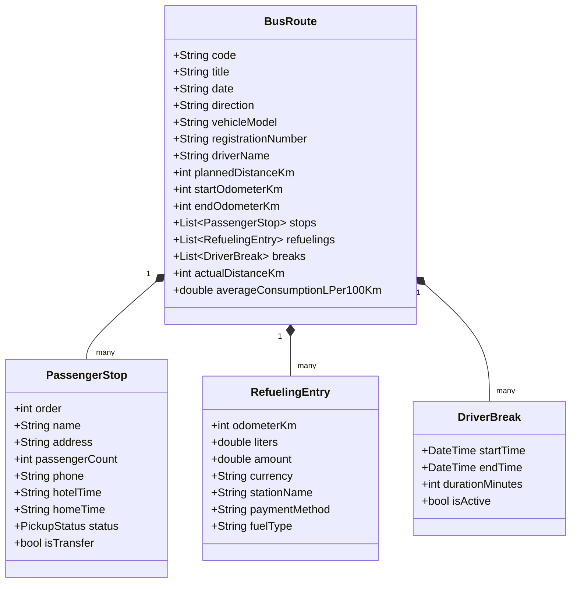
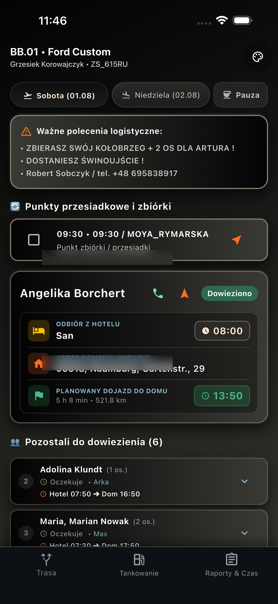

<div align="center">

  

  # BalticBus Driver & Fleet Assistant
  ### Nowoczesny system zarządzania trasami, flotą i rozliczeniami dla międzynarodowego przewozu osób (PL ⇄ DE)

  [](https://flutter.dev)
  [](https://dart.dev)
  [](https://developer.android.com)
  [](https://developer.android.com)
  [](https://github.com)
  [](#)

</div>

---

## 📌 Spis treści
1. [Wprowadzenie i Cel Projektu](#-wprowadzenie-i-cel-projektu)
2. [Główne Moduły i Funkcjonalności](#-główne-moduły-i-funkcjonalności)
3. [Architektura Systemu](#-architektura-systemu)
4. [Silnik Personalizacji i Motywy](#-silnik-personalizacji-i-motywy)
5. [Technologie i Wykorzystane Biblioteki](#-technologie-i-wykorzystane-biblioteki)
6. [Model Domenowy (Data Model)](#-model-domenowy-data-model)
7. [Zrzuty Ekranu i Przepływ Pracy Kierowcy](#-zrzuty-ekranu-i-przepływ-pracy-kierowcy)
8. [Instalacja i Uruchomienie](#-instalacja-i-uruchomienie)
9. [Testy i Zapewnienie Jakości](#-testy-i-zapewnienie-jakości)

---

## 🚀 Wprowadzenie i Cel Projektu

**BalticBus Driver & Fleet Assistant** to wyspecjalizowana aplikacja mobilna stworzona dla kierowców i dyspozytorów międzynarodowych przewozów pasażerskich na linii **Polska ⇄ Niemcy**.

Aplikacja rozwiązuje kluczowe wyzwania operacyjne firm przewozowych:
* **Eliminacja papierowych kart drogowych**: Wszystkie dane trasy, pasażerów i transferów dostępne w jednym, intuicyjnym panelu.
* **Automatyczny import z Excela (`.xlsx`)**: Błyskawiczne wczytywanie dwudniowych harmonogramów weekendowych (Sobota PL ➔ DE, Niedziela DE ➔ PL) dla całej floty (BB.01, BB.02, BB.03...).
* **Precyzyjna telemetria i ewidencja kosztów**: Monitorowanie przebiegów (początkowy/końcowy licznik km), rozliczanie tankowań (Diesel ON, AdBlue, waluty PLN/EUR, formy płatności) oraz średniego spalania (l/100 km).
* **Zgodność z normami czasu pracy**: Rejestrator przerw kierowcy w czasie rzeczywistym z timerem i alertami.
* **Automatyczny generator rozliczeń Word (`.docx`)**: Generowanie gotowych protokołów rozliczeniowych weekendu z bilansowaniem zaliczek, pobranej gotówki i salda kierowcy.

---

## ⚡ Główne Moduły i Funkcjonalności

### 1. 📋 Inteligentny Parser Harmonogramów Excel (`ExcelParserService`)
* **Wielobranżowe mapowanie kolumn**: Samodzielnie analizuje złożone arkusze dyspozytorskie, rozpoznając bloki busów (`BB.xx`), trasy tam i powrót.
* **Automatyczne rozpoznawanie przesiadek**: Identyfikacja pasażerów transferowych (brak adresu w Niemczech, kody `XXX`, adnotacje dyspozytora) i dynamiczne przypisywanie punktów przesiadkowych.
* **Walidacja danych kontaktowych**: Separacja wielokrotnych numerów telefonów pasażerów rozdzielonych separatorem `/` z możliwością wyboru numeru przed połączeniem.

### 2. 🗺️ Manifest Pasażerski i Integracja z Nawigacją (`LauncherService`)
* **Obsługa statusów pasażera**: `Oczekuje`, `Odebrany`, `Dowieziony`, `Nieobecny (No-show)`, `Anulowany`.
* **One-Tap Dialing**: Bezpośrednie wywołanie dialera systemowego z poziomu karty pasażera.
* **One-Tap Navigation**: Uruchomienie natywnej nawigacji (Google Maps / Apple Maps / Geo URI) do dokładnego adresu pasażera lub hotelu.
* **Podgląd trasy zbiorczej**: Otwieranie pełnej sekwencji trasy w Google Maps.

### 3. ⛽ Ewidencja Tankowań i Paliwa (`RefuelingEntry`)
* Szczegółowy rejestr każdego tankowania: stan licznika, litry, kwota, waluta (**PLN / EUR**), stacja (**MOYA flota**, stacje w Niemczech), metoda płatności.
* Rozdzielenie paliwa **Diesel (ON)** od **AdBlue** – średnie spalanie (l/100 km) kalkulowane jest ściśle na podstawie faktycznie spalonego oleju napędowego.

### 4. ⏱️ Rejestrator Czasu Pracy i Przerw (`DriverBreak`)
* Timer na żywo odliczający czas trwającej pauzy kierowcy.
* Pełna historia przerw z podsumowaniem łącznego czasu odpoczynku na trasie.

### 5. 📑 Finansowe Rozliczenie Weekendu i Eksport DOCX (`DocxReportService` & `ReportService`)
* Bilansowanie zaliczek pobranych przez kierowcę (**Zaliczka EUR, Zaliczka PLN**).
* Sumowanie zebranej gotówki od pasażerów.
* Zestawienie wydatków trasowych (paliwo, opłaty).
* **Natywny generator DOCX**: Tworzenie sformatowanego dokumentu Microsoft Word (`Plan_Jazdy_BBxx_Data.docx`) z pełnymi tabelami rozliczeniowymi bez konieczności korzystania z zewnętrznych serwerów w chmurze (pełna prywatność i praca offline).

---

## 🏗️ Architektura Systemu

Projekt zorganizowano w oparciu o wzorce **Clean Architecture** i podejście **Service-Oriented** gwarantujące wysoką skalowalność, testowalność i niezależność od platformy:

```
lib/
├── data/
│   └── sample_routes.dart          # Dane demonstracyjne i wzorce tras
├── models/
│   └── route_models.dart           # Modele domenowe (BusRoute, PassengerStop, RefuelingEntry, DriverBreak)
├── services/
│   ├── excel_parser_service.dart   # Parser arkuszy kalkulacyjnych .xlsx
│   ├── docx_report_service.dart    # Kompilator dokumentów Word (.docx XML/ZIP)
│   ├── report_service.dart         # Silnik analityczno-finansowy i obliczenia spalania
│   ├── launcher_service.dart       # Integracje natywne (telefon, mapy, schowek)
│   └── storage_service.dart        # Warstwa trwałości danych (SharedPreferences)
├── theme/
│   └── app_colors.dart             # Zunifikowany system kolorów i motywów
└── main.dart                       # Główny interfejs kierowcy, dashboard i nawigacja
```

### Schemat Przepływu Danych

```mermaid
flowchart LR
    A["Plik Excel (.xlsx)"] -->|Import| B["ExcelParserService"]
    B -->|Model Domenowy| C["BusRoute / WeekendTripSummary"]
    C <-->|Trwałość danych (Offline)| D["StorageService (Local DB)"]
    C -->|UI & Telemetria| E["Dashboard & Manifest Pasażerów"]
    E -->|Zdarzenia kierowcy| F["Pauzy, Liczniki, Tankowania"]
    F --> C
    C -->|Finanse i Spalanie| G["ReportService"]
    G -->|Generowanie DOCX| H["Plik Word (.docx)"]
```

---

## 🎨 Silnik Personalizacji i Motywy

Aplikacja posiada dedykowany silnik motywów dostosowany do pracy w kabinie pojazdu w zróżnicowanych warunkach oświetleniowych:

| Motyw | ID | Charakterystyka | Zastosowanie |
| :--- | :--- | :--- | :--- |
| **BALTIC NOIR** | `balticNoir` | Głęboka czerń z ciepłym akcentem `#FFE7D0` | Domyślny, oszczędzający baterię OLED w nocy |
| **BALTIC ORANGE** | `balticOrange` | Ciemny grafit z dynamicznym akcentem `#FC6E20` | Wysoki kontrast przy słonecznym dniu |
| **CHARCOAL NOIR** | `charcoalNoir` | Stonowany grafit i platynowy akcent `#B0B5BD` | Elegancki, minimalistyczny styl |

---

## 🛠️ Technologie i Wykorzystane Biblioteki

| Narzędzie / Biblioteka | Wersja | Zastosowanie |
| :--- | :--- | :--- |
| **Flutter SDK** | `^3.13.7` | Wieloplatformowy framework UI |
| **Dart** | `>=3.0.0` | Język programowania ze ścisłym systemem typów |
| **excel** | `^4.0.6` | Dekodowanie i parsowanie arkuszy xlsx w pamięci |
| **archive** | `^3.6.1` | Tworzenie kontenerów ZIP dla standardu OpenXML (.docx) |
| **shared_preferences**| `^2.3.4` | Szybki, bezawaryjny magazyn klucz-wartość offline |
| **url_launcher** | `^6.3.1` | Bezpośrednia integracja z telefonią i mapami |
| **file_picker** | `^8.1.7` | Bezpieczny wybór plików z pamięci urządzenia |

---

## 📊 Model Domenowy (Data Model)



---

## 📱 Zrzuty Ekranu i Interfejs Aplikacji

<div align="center">
  <table>
    <tr>
      <th align="center">1. Wybór Trasy i Harmonogram</th>
      <th align="center">2. Pulpit Kierowcy i Pauza</th>
    </tr>
    <tr>
      <td align="center" width="50%">
        
      </td>
      <td align="center" width="50%">
        
      </td>
    </tr>
    <tr>
      <th align="center">3. Manifest Pasażerski i Przesiadki</th>
      <th align="center">4. Raport Finansowy i DOCX</th>
    </tr>
    <tr>
      <td align="center" width="50%">
        
      </td>
      <td align="center" width="50%">
        
      </td>
    </tr>
  </table>
</div>

---

## 💻 Instalacja i Uruchomienie

### Wymagania wstępne:
* Flutter SDK (`>= 3.13.7`)
* Android Studio / VS Code ze wsparciem Flutter/Dart
* Android SDK (API 34–36)

### Krok po kroku:

```bash
# 1. Klonowanie repozytorium
git clone https://github.com/twoja-organizacja/balticbus.git
cd balticbus

# 2. Pobranie zależności
flutter pub get

# 3. Uruchomienie testów jednostkowych
flutter test

# 4. Uruchomienie w trybie developerskim
flutter run
```

---

## 🧪 Testy i Zapewnienie Jakości

Projekt posiada zautomatyzowane testy jednostkowe i widgetowe weryfikujące:
* Prawidłowość kalkulacji średniego spalania (eliminacja AdBlue z obliczeń spalanego diesla).
* Poprawność bilansowania salda kierowcy w raporcie weekendowym.
* Dynamiczne przełączanie motywów i zachowanie integralności interfejsu.
* Parsowanie formatów dat i specyfiki adresów transferowych.

```bash
flutter test
# Wynik: All tests passed! (12/12)
```

---

<div align="center">
  <sub>Projekt zrealizowany dla <b>BalticBus</b>. Wszelkie prawa zastrzeżone © 2026.</sub>
</div>
