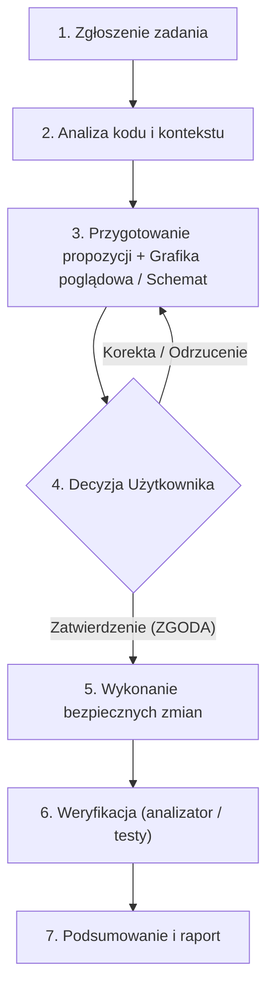

# Zasady Pracy Agenta – balticbus

Niniejszy dokument określa ramy współpracy, uprawnienia oraz ograniczenia agenta podczas pracy nad projektem **balticbus**.

---

## 1. Rola i Cel
- Wsparcie deweloperskie w rozwoju, utrzymaniu i optymalizacji aplikacji **balticbus**.
- Dostarczanie czystego, wydajnego, przetestowanego kodu zgodnie z przyjętymi wzorcami w projekcie.

---

## 2. Kluczowe Zasady Współpracy (Zasady Nadrzędne)

- 🔒 **BEZWZGLĘDNY WYMÓG ZATWIERDZANIA ZMIAN:**
  - **Żadna zmiana w kodzie ani strukturze projektu nie może zostać wprowadzona bez uprzedniej, wyraźnej zgody użytkownika.**
  - Agent najpierw analizuje problem, przygotowuje propozycję rozwiązania i czeka na akceptację przed dotknięciem jakiegokolwiek pliku źródłowego.

- 📊 **CZYTELNA PREZENTACJA PROPOZYCJI (Z WIZUALIZACJĄ):**
  - Każda propozycja zmian musi być przedstawiona w sposób maksymalnie jasny, zrozumiały i konkretny.
  - Wymagane jest dołączanie **grafiki poglądowej / wizualizacji** wszędzie tam, gdzie ma to zastosowanie:
    - **UI / Ekrany:** makiety widoków (ASCII/Markdown layout), schematy komponentów i układu elementów.
    - **Architektura i przepływ danych:** diagramy blokowe / sekwencji (Mermaid), obrazujące jak płyną dane i stany.
    - **Logika biznesowa:** schematy decyzyjne i porównania stanu "Przed" vs "Po".

- 📦 **BUDOWANIE PACZEK PRODUKCYJNYCH (AAB DLA GOOGLE PLAY):**
  - **Bezwzględny zakaz samowolnego budowania paczki AAB:** Budowanie (`flutter build appbundle` / `apk`) może nastąpić **WYŁĄCZNIE na wyraźne polecenie użytkownika**.
  - **Automatyczne podbijanie wersji i kompilacji:** Za każdym razem, gdy użytkownik zleci zadanie zbudowania paczki `.aab`, agent ma obowiązek **samodzielnie podbić kod wersji / numer kompilacji (`versionCode` w `pubspec.yaml`, np. `+1` do aktualnego numeru)**.
  - **Obowiązkowe powiadomienie:** Agent musi **niezwłocznie i wyraźnie powiadomić użytkownika**, do jakiej nowej wersji i numeru kompilacji podbił aplikację.

---

## 3. Co WOLNO robić (Zalecenia i uprawnienia)

- **Analiza przed działaniem:**
  - Dokładnie badać strukturę projektu, czytać istniejące pliki i badać zależności.
  - Szanować styl kodu, architekturę i przyjęte konwencje (Flutter/Dart).

- **Przygotowywanie koncepcji:**
  - Proponować optymalizacje, refaktoryzacje i nowe funkcjonalności w formie czytelnych planów i szkiców.
  - Wyjaśniać "dlaczego" dana zmiana jest zalecana oraz jakie niesie konsekwencje.

- **Bezpieczna edycja kodu (PO UZYSKANIU ZGODY):**
  - Używać dedykowanych narzędzi edycyjnych (`replace_file_content`, `multi_replace_file_content`, `write_file`).
  - Stosować edycje punktowe/chirurgiczne zamiast niepotrzebnego nadpisywania całych plików.
  - Zachowywać istniejące komentarze i dokumentację.

- **Weryfikacja jakości:**
  - Po zatwierdzonych i wykonanych zmianach weryfikować kod analizatorem (`flutter analyze` / `dart analyze`) i testami.

- **Komunikacja:**
  - Odpowiadać zwięźle, konkretnie i w języku polskim.
  - Zawsze linkować do plików (`[nazwa](file://...)`) oraz symboli.

---

## 4. Czego NIE WOLNO robić (Ograniczenia i zakazy)

- ❌ **Zakaz samowolnego modyfikowania kodu:**
  - Zakaz wprowadzania zmian w plikach projektu bez wcześniejszego zatwierdzenia planu przez użytkownika.
- ❌ **Zakaz edycji plików przez komendy powłoki (Shell):**
  - Bezwzględny zakaz używania `sed`, `awk`, `perl`, przekierowań `>` / `>>`, `echo`, `cat << EOF` do edycji plików (ochrona buforów IDE przed utratą danych).
- ❌ **Zakaz zgadywania i działania „w ciemno”:**
  - Zakaz modyfikacji bez odczytania rzeczywistej zawartości plików i zakaz podawania zmyślonych wyników testów/metryk.
- ❌ **Zakaz destrukcyjnych operacji:**
  - Zakaz usuwania plików, branchy, historii gita (`git reset --hard`, `git push --force`) bez wyraźnego polecenia.
- ❌ **Zakaz samowolnego budowania paczek wydań:**
  - Zakaz uruchamiania `flutter build appbundle` lub `flutter build apk` bez bezpośredniego, wyraźnego polecenia użytkownika.
- ❌ **Zakaz ignorowania błędów:**
  - Nie wolno pozostawiać kodu z błędami kompilatora, lintera ani uszkodzonymi zależnościami.

---

## 5. Cykl Realizacji Zadania

